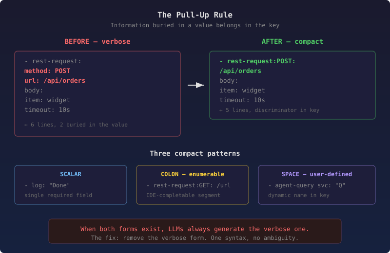

# The Syntax the LLM Always Gets Wrong

I've spent the last two days ripping verbose syntax out of our YAML playbook DSL. Not because the verbose form was broken — it parsed fine, the tests passed, the playbooks ran. The problem was subtler: every time an LLM generated a playbook, it produced the verbose form. Every time.

We had two ways to write a REST call:

```yaml
# Verbose — what the LLM always generates
- rest-request:
    method: POST
    url: /api/orders
    body:
      item: widget
  timeout: 10s

# Compact — what a human would write
- rest-request:POST: /api/orders
  body:
    item: widget
  timeout: 10s
```

Both parsed. Both executed. But the compact form puts the discriminator — the HTTP method — in the YAML key where it belongs. The verbose form buries it two levels deep in a map value. An LLM scanning the schema sees both forms, and it picks the one with more structure. More tokens, more explicit nesting, more surface area for the model to latch onto. The verbose form is a statistical attractor.

This isn't a prompting problem. You can tell the model to prefer the compact form. It will, for about three examples, then drift back. The verbose form has more training signal behind it — YAML maps with named keys are everywhere in the model's training data. A YAML key with a colon-separated compound like `rest-request:POST:` is unusual enough that the model treats it as an edge case to be avoided.

## The pull-up rule

The fix isn't better prompts. It's removing the verbose form entirely so the parser rejects it.

But before removing anything, we needed a principle for deciding what belongs in the key versus the value. I call it the pull-up rule: **when a field inside a map value is the discriminator — the thing that tells you what this step does — it belongs in the key, not the value.**



HTTP method is the discriminator for a REST call. Session name is the discriminator for an agent query. Tool name is the discriminator for an MCP call. Command name is the discriminator for a process step. These were all buried inside map values, forcing the reader (and the LLM) to look inside the value to understand what the step does.

The corollary: once the discriminator is in the key, if only one field remains in the value, collapse the map to a scalar. `log: { message: "Done" }` becomes `log: "Done"`. The `message` key adds no information — `log` only has one required input.

## Three patterns fell out

The discriminator's nature determines the compound key syntax:

**Scalar shorthand** — when the action has a single required field, the value is just the value. No map, no key name.

```yaml
- log: "Order processed"
- click: "Submit"
- flag-set: "ready"
```

**Colon compound** — when the discriminator is enumerable (HTTP methods, runtimes), it goes after a colon. The IDE can complete it because the set is known.

```yaml
- rest-request:POST: /api/orders
- script-run:python3: "import json; ..."
- await:signal: go
```

**Space compound** — when the discriminator is user-defined (session names, task IDs, device names), it goes after a space. No IDE completion for the dynamic part, but the action prefix still completes.

```yaml
- agent-query order-agent: "Check order status"
- spawn-task indexer: { duration: 800 }
- counter-add requests: { delta: 1 }
```

The Walker's combined-key parser already handled space compounds for structural types like `block myblock:` and `forEach item in items:`. We extended it to also try colon-prefix matching, then space-prefix matching, for any registered action. One parser change, every action benefits.

## primaryInput — the scalar shorthand that works automatically

The scalar shorthand needed one more piece. When the Walker encounters `log: "Done"`, it puts the string value into the action's params. But which param key? The original code used a generic `_subject` key — every plugin then had to check for `_subject` as a fallback for its primary field.

The fix was obvious in hindsight: the `Definition` already declares its inputs with `required: true`. The first required input is the primary field. `log`'s first required input is `message`. `click`'s first required input is `name`. So `log: "Done"` produces `params.message = "Done"` directly — no `_subject` indirection, no per-plugin awareness. Every plugin with a declared required input gets scalar shorthand for free.

```java
public String primaryInput() {
    for (var entry : inputs.entrySet()) {
        if (entry.getValue().required()) {
            return entry.getKey();
        }
    }
    return null;
}
```

## Fail fast, not deprecation warnings

The temptation was to deprecate the verbose forms — log a warning, keep parsing both, migrate gradually. I've seen where that leads. Six months later the deprecated form is still everywhere because nothing forces migration. The LLM still generates it because the parser still accepts it.

We went the other way. The `PlaybookCompiler` rejects verbose forms for `rest-request`, `agent-session-open`, `agent-query`, `mcp-call`, and `process-exec` with a clear error:

```
Verbose 'rest-request:' form is removed — use compact: rest-request:METHOD: URL
```

The schema was updated to remove the verbose properties entirely. The IDE no longer suggests them. The LLM no longer sees them. There is one syntax, and it's the compact one.

## What the numbers say

Across the platform playbook catalog — 73 tutorial playbooks covering every step type, structural pattern, and coordination primitive — the conversion eliminated over 160 verbose patterns:

- ~65 `log: { message: "..." }` → `log: "..."`
- ~70 `click: { role: button, name: "..." }` → `click: "..."`
- ~60 coordination primitives collapsed to scalar or name-in-key forms
- ~15 `await: { signal/barrier: X }` → `await:signal: X`

The same conversion propagated to `life` (29 REST calls across 11 playbooks), `iot` (8 step name conversions), and `clinical` (9 step name conversions).

Net effect: same semantics, fewer lines, one unambiguous syntax per action.

## The deeper point

This wasn't about saving keystrokes. It was about recognising that a YAML DSL consumed by both humans and LLMs has a design constraint that pure-human DSLs don't: **ambiguity in syntax is ambiguity in generation.** When two forms mean the same thing, the LLM will pick the wrong one reliably. Not because it's bad at following instructions, but because its statistical model of "what YAML looks like" pulls it toward the more conventional structure.

The fix is mechanical: identify the discriminator, pull it into the key, remove the verbose form. But the insight is architectural. A DSL designed for LLM consumption should have exactly one way to express each concept. Not "here's the shorthand, but the verbose form still works." One form. The one you want generated.
